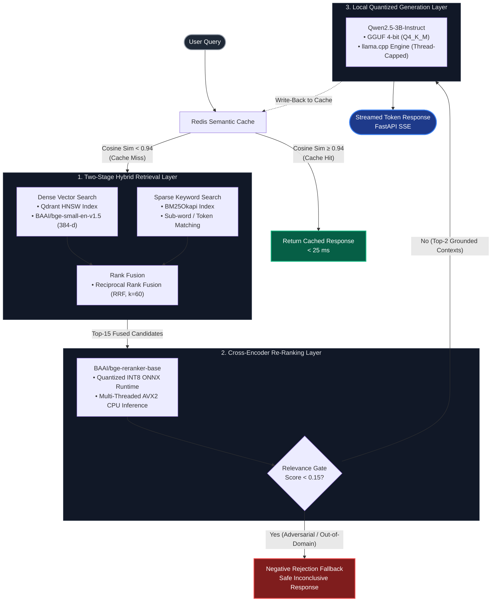

Dataset: The PubMed Central Open Access dataset contains millions of full-text papers; we will use a high-quality clinical subset of 5000 pathology papers for this project.

##  Project Structure & Data Pipeline

Large binary artifacts (embeddings, vector indices, raw corpora) are excluded from version control via `.gitignore` to keep the repository lightweight. A reproducible data script is included to generate local assets.

```text
clinical_rag_engine/
├── data/
│   ├── download_data.py          # Tracked: Pulls & parses open-access PMC dataset
│   ├── processed_chunks.jsonl    # Ignored: 148k processed text chunks
│   ├── vectors_384d.npy          # Ignored: Precomputed 384-d dense embeddings
│   ├── bm25_index.pkl            # Ignored: Pickled sparse BM25 token index
│   └── metadata.pkl              # Ignored: Chunk metadata lookup store
├── models/                       # Ignored: GGUF weights & quantized ONNX models
├── qdrant_storage/               # Ignored: Local Qdrant HNSW vector persistence
├── src/                          # Core RAG source code
│   ├── api/                      # FastAPI service & Redis semantic cache
│   ├── evaluation/               # Robustness & benchmark test harnesses
│   ├── generator/                # llama.cpp local quantized inference
│   └── retrieval/                # Hybrid search (Dense + BM25 + RRF) & ONNX reranker
├── .gitignore
├── README.md
└── requirements.txt
```

### Reproducing Data Locally

To populate the local `data/` directory with the PMC chunks:

```bash
python data/download_data.py
```


